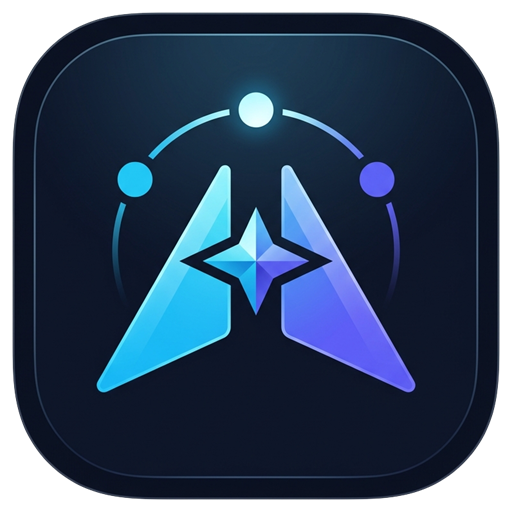
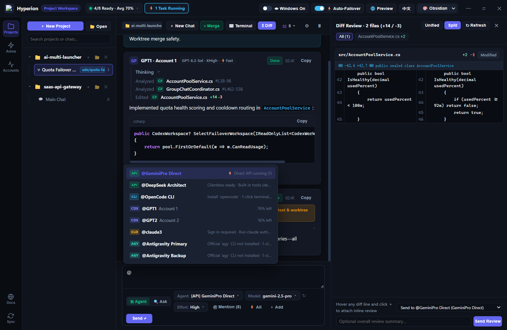
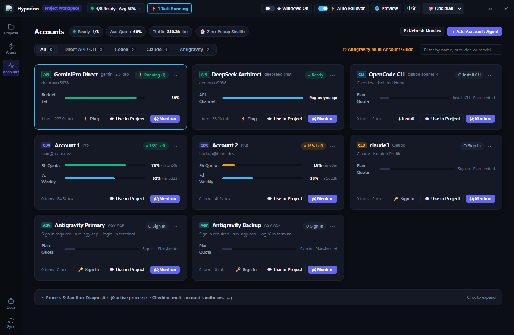
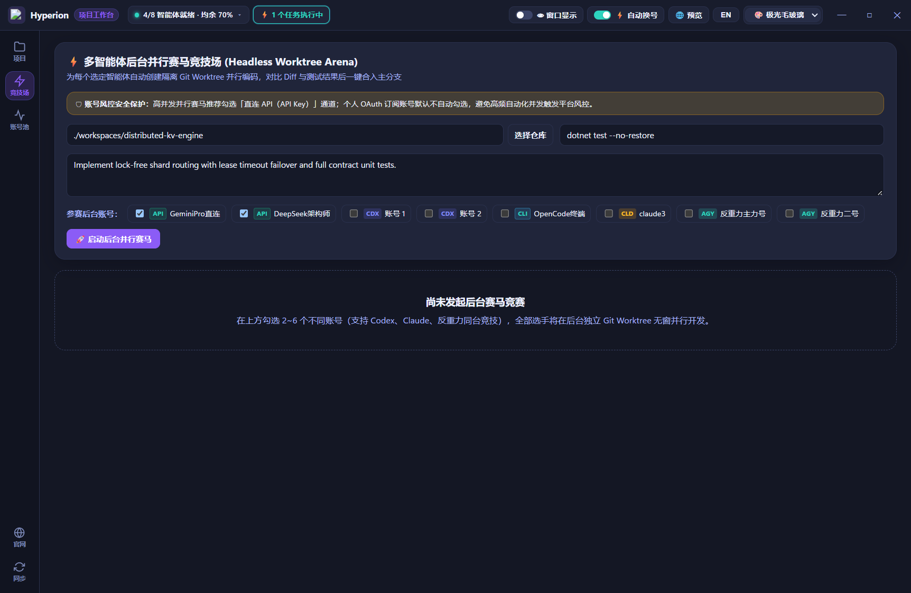
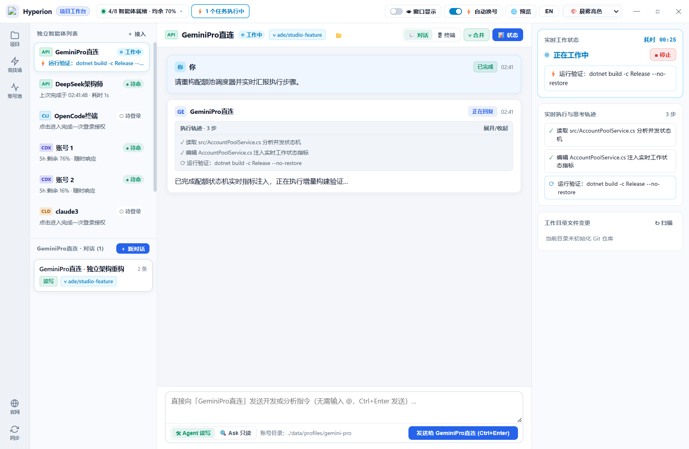
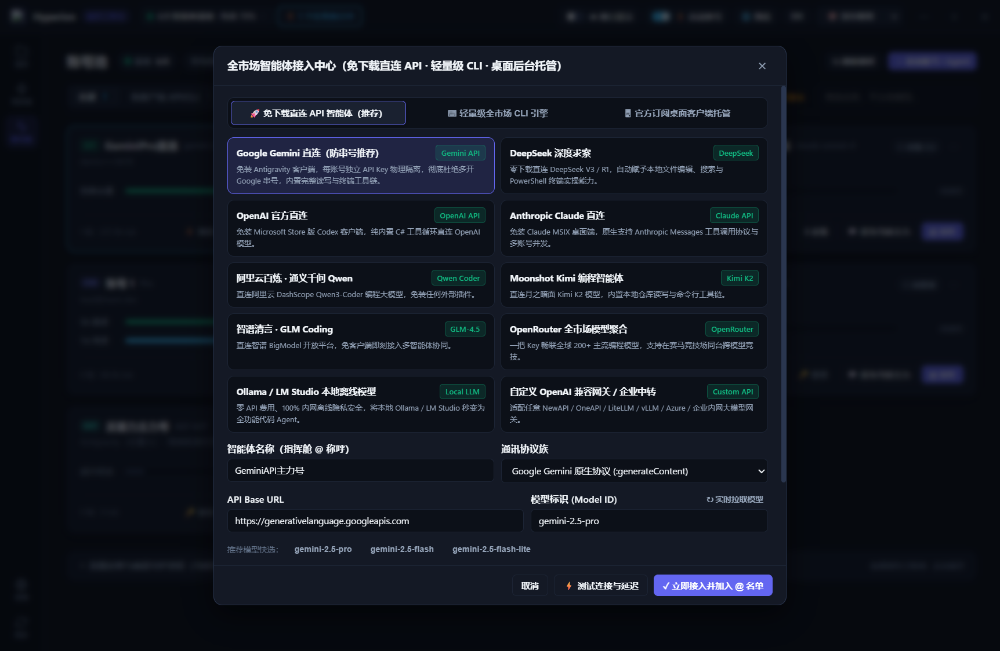

<div align="center">
  
  <h1>Hyperion</h1>
  <p><strong>Universal Multi-Agent Command Flagship, Isolated Account Pool &amp; Headless Git Worktree Arena for Windows</strong></p>
  <p><strong>多智能体总控指挥舰 · Windows 多账号物理隔离、429 自动换号接力、动态模型/思考强度切换与 Git Worktree 并行赛马工作台</strong></p>

  <p>
    <a href="README.md"></a>
    <a href="README.zh-CN.md"></a>
    <a href="https://github.com/ThalesNotTychus/Hyperion/releases/latest"></a>
  </p>

  <p>
    
    
    
    
    <a href="LICENSE"></a>
  </p>
</div>

<p align="center">
  
</p>

---

## Why Hyperion?

Heavy AI developers routinely juggle multiple subscriptions and APIs (**Codex**, **Claude Code**, **Antigravity**, **Gemini CLI**, **OpenCode**, **Aider**, **DeepSeek**, **OpenRouter**, **Ollama**) — and hit the exact same walls every day:

| Everyday Pain Point | How Hyperion Solves It |
| :--- | :--- |
| **Account Cross-Contamination on Windows** | Physical per-account directory & environment isolation (`CODEX_HOME`, `CLAUDE_CONFIG_DIR`, `USERPROFILE`, `APPDATA`, `ANTIGRAVITY_GEMINI_DIR`, `ANTIGRAVITY_CREDENTIAL_SCOPE`). Run multiple accounts concurrently without session overwrites. |
| **Mid-Task `429` Quota Exhaustion** | **Battery-Style Quota Telemetry & Auto-Failover (`AccountPoolService`)**: monitors live 5h/7d remaining quotas (`codex app-server` & official `agy -p /usage`) and automatically fails over to the healthiest backup account or API node in the same Git worktree without losing context. |
| **Agents Overwriting Each Other's Files** | **One-Click Git Worktrees & Headless Arena**: fan out the same prompt to 2–6 models in isolated Git worktrees, run automated test suites (`dotnet test` / `npm test`), inspect **Unified/Split Diffs** with inline line-level review comments, and merge the winner cleanly. |
| **Opaque Thinking & Hardcoded Model Lists** | **Live Model, Reasoning Effort & Fast-Mode Discovery (`ModelCatalogService`)**: dynamically queries `codex app-server` `model/list`, official Antigravity `agy acp` `session/new` `configOptions`, `/v1/models`, `/v1beta/models`, and Ollama `/api/tags` with native thinking timeline streaming. |
| **Heavy Multi-GB Electron Clients & Taskbar Clutter** | **3-Tier Execution Engine**: includes a **Zero-Download Built-In C# Agent Loop** (native OpenAI, Anthropic Messages & Gemini SSE protocols), a **Lightweight CLI Runner**, and **Zero-Popup Headless Stealth Mode (`SW_HIDE`)** for official desktop clients. |
| **Plaintext API Keys on Disk** | Never reads, copies, or parses official `auth.json` tokens. All direct API keys are hardware-encrypted locally via **Windows DPAPI (`CryptProtectData`)**. |

---

## Visual Tour

<table>
  <tr>
    <td width="50%">
      
      <p align="center"><strong>Account &amp; Quota Pool</strong><br/>Live 5h/7d battery meters, token budgets &amp; 1-click failover pool</p>
    </td>
    <td width="50%">
      
      <p align="center"><strong>Headless Worktree Arena</strong><br/>Benchmark 2–6 agents in isolated Git branches with automated test verification</p>
    </td>
  </tr>
  <tr>
    <td width="50%">
      
      <p align="center"><strong>Live Thinking &amp; Tool Timeline</strong><br/>Real-time reasoning trace, embedded ConPTY TUI &amp; working tree diff</p>
    </td>
    <td width="50%">
      
      <p align="center"><strong>Universal Agent Hub</strong><br/>Zero-download Direct APIs, 1-click Market CLIs &amp; isolated desktop instances</p>
    </td>
  </tr>
</table>

---

## Key Capabilities

### 1. Three-Tier Universal Agent Engine + Dynamic Model / Effort / Speed Control
- **Native Model, Effort & Fast-Mode Adaptation**: Switch concrete models (`GPT`, `Gemini`, `Claude`, `DeepSeek`, `Ollama`), reasoning effort (`Minimal` / `Low` / `Medium` / `High` / `XHigh` / `Max`), and priority speed tiers (`⚡ Fast` / `⚡⚡ Ultrafast`) directly in the composer bar.
- **Zero-Download Direct API Agent (`BuiltInApiAgentRunner`)**: Turn any API key (OpenAI, Anthropic Claude, Google Gemini Native, DeepSeek, Qwen, Kimi, GLM, OpenRouter) or local **Ollama / LM Studio** model into an autonomous local coding agent with built-in sandboxed `list_files`, `read_file`, `write_file`, `edit_file`, and windowless `run_command` tools.
- **Official ACP & Lightweight CLI Adapter (`AntigravityAgentRunner` & `GenericCliAgentRunner`)**: Connects to Google Antigravity strictly via the official public **Agent Client Protocol (`agy acp` JSON-RPC 2.0 over `stdio`)**, and auto-discovers or installs `codex`, `claude`, `gemini`, `opencode`, `aider`, `qwen`, `goose`, or custom CLI templates in an embedded ConPTY terminal.
- **Official Desktop Profile Isolation (Optional)**: Manages isolated user-data profiles for official desktop clients without reading, extracting, or proxying OAuth credentials.

### 2. Project-First Workspace, `@` Multi-Agent Orchestration & Inline Split-Diff Review
- Create or open any local project folder and press `Enter` to work 1-on-1 with your active primary agent, or type `@GPT1 @Claude @GeminiPro` anytime to collaborate across multiple agents in the same thread.
- Inspect every agent modification in the **Unified / Split Diff Drawer**, attach line-by-line review notes, and dispatch structured rework instructions back to any `@Agent` before merging `--no-ff` into your main branch.

### 3. Built-In Design Mode (`Dual WebView2` DOM & Viewport Inspector)
- Preview local web apps (`http://localhost:3000`, `5173`, etc.) side-by-side, click any live DOM element to extract its selector, computed CSS, HTML snippet, and viewport screenshot directly into your agent prompt.

### 4. Four Tactile Themes & Instant `EN / 中文` Toggle
- Switch instantly between **Obsidian**, **Matrix**, **Daylight**, and **Aurora** themes, as well as **English / Simplified Chinese** UI localization.
- Compiles into a single self-contained `Hyperion.exe` serving embedded UI assets over a virtual secure origin — **zero Node.js runtime, zero open localhost ports**.

---

## Quick Start

### Option A: Download Portable Single-File Release (Recommended)
1. Download `Hyperion-portable-win-x64.zip` from [**Releases**](../../releases).
2. Extract to any folder on **Windows 10 / 11 (x64)** and launch `Hyperion.exe`.
   > *Note:* Because community open-source builds are unsigned, Windows Defender SmartScreen may display a *"Windows protected your PC"* prompt on first launch. Click **More info → Run anyway** (you can verify integrity against `SHA256SUMS.txt` on the Release page, or build directly from source below).
3. Create or open any local project folder, pick your active agent, model, reasoning effort, and speed tier in the composer bar, and start building!

### Option B: Build from Source

Prerequisites: Windows 10/11 (with Edge WebView2 Runtime), PowerShell 5.1+ (or `pwsh` 7+), Git, and **.NET 10 SDK**.

```powershell
# Build solution & run full contract tests + WebView2 layout verification + portable release publish
powershell -NoProfile -ExecutionPolicy Bypass -File .\scripts\Accept-Release.ps1
```

Or build and run directly during development:

```powershell
dotnet build Hyperion.sln -c Release
dotnet run --project src/CodexMultiLauncher/CodexMultiLauncher.csproj -c Release
```

---

## Security & Compliance Design

- **Zero Credential Harvesting**: Hyperion **never** reads, decrypts, copies, or modifies official `auth.json` or browser cookies. Official OAuth sessions are isolated purely via OS process environment blocks and separate user-data directories.
- **Hardware-Backed Secret Storage**: User-supplied API keys are encrypted at rest with **Windows DPAPI (`CryptProtectData` / `CurrentUser`)** and stripped from child environments unless explicitly bound to that isolated runner.
- **Strict Path & Symlink Containment**: Every workspace write and worktree operation validates canonical path containment and rejects NTFS reparse points / directory junctions (`ProfilePathSafety`).

---

## Architecture

See [`docs/ARCHITECTURE.md`](docs/ARCHITECTURE.md) for deep dives into the `.NET 10 + Dual WebView2` host bridge, `AccountPoolService` failover state machine, `ModelCatalogService` runtime discovery, `ConPtyTerminalService` pseudo-console lifecycle, MSIX `PackageDebugSettings` isolation, and `GitWorktreeService` safety invariants.

---

## License & Disclaimer

Released under the [MIT License](LICENSE).

**Bring Your Own Agent (BYOA) & Trademark Notice:**  
Hyperion is an independent, community-built open-source orchestration workspace. It does **not** bundle, host, proxy, modify, or resell any proprietary AI models, subscriptions, or third-party binaries, nor does it read or extract official authentication tokens. Users supply their own legally obtained CLI tools, subscriptions, or API keys in accordance with each provider's terms of service.  
*OpenAI, Codex, Anthropic, Claude, Google, Gemini, and Antigravity are trademarks or service marks of their respective owners. This project is not affiliated with, endorsed by, or sponsored by OpenAI, Anthropic, Google, or any other model provider.*
