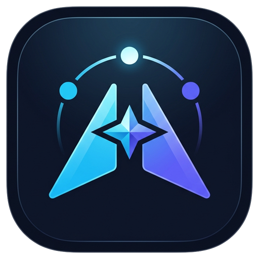
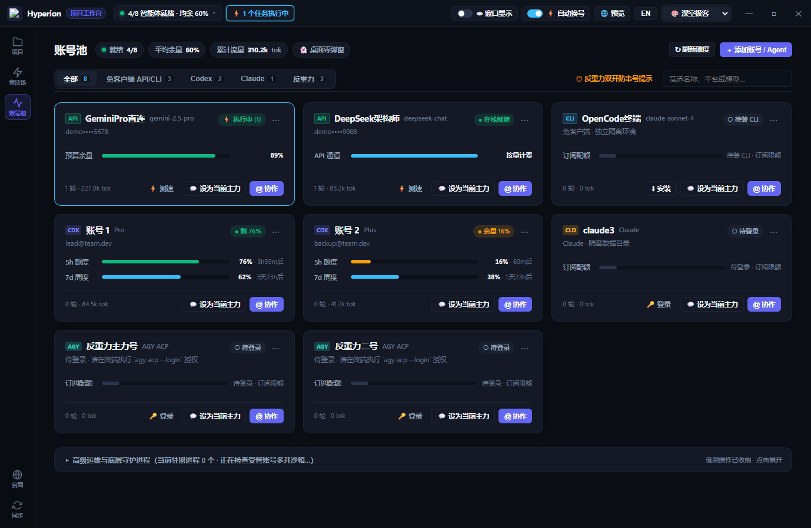
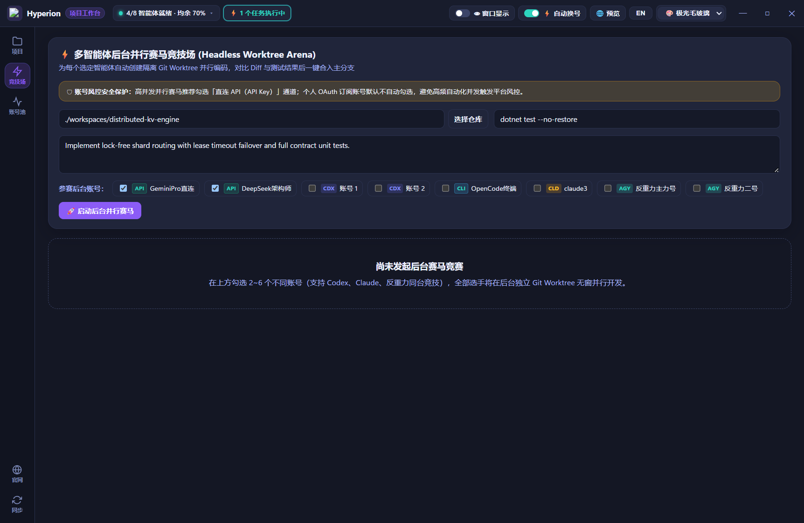
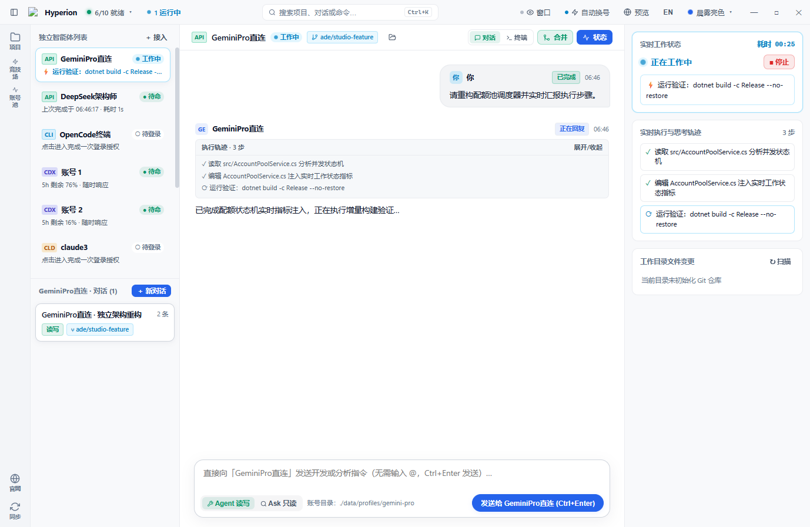
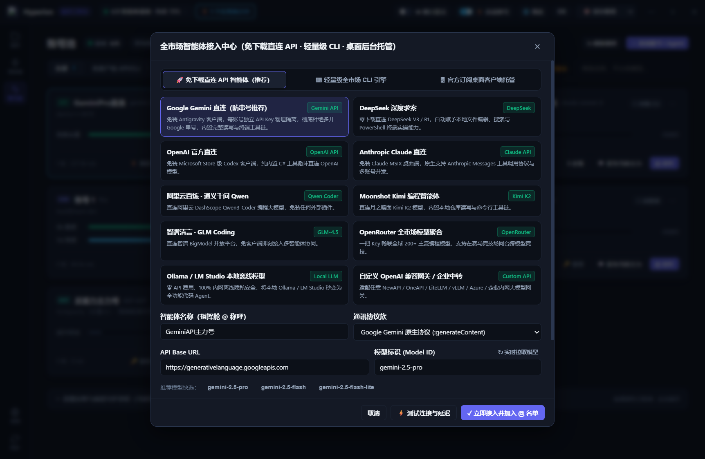

<div align="center">
  
  <h1>Hyperion · 休伯利安多智能体总控指挥舰</h1>
  <p><strong>基于 .NET 10 原生内核 + WebView2 + ConPTY 的 Windows 多账号物理隔离、429 自动折跃接力与 Git Worktree 赛马工作台</strong></p>
  <p><em>Universal Multi-Agent Command Flagship, Isolated Account Pool &amp; Headless Git Worktree Arena for Windows</em></p>

  <p>
    <a href="https://thalesnottychus.github.io/Hyperion/"></a>
    <a href="https://github.com/ThalesNotTychus/Hyperion/discussions"></a>
    <a href="https://github.com/ThalesNotTychus/Hyperion/releases/latest"></a>
    <a href="README.md"></a>
  </p>

  <p>
    
    
    
    
    <a href="LICENSE"></a>
  </p>
</div>

<p align="center">
  
</p>

<p align="center">
  📖 <strong>深度实战手册：</strong>
  <a href="https://thalesnottychus.github.io/Hyperion/guides/multi-account-isolation.html">Windows 多账号物理防串号</a> ·
  <a href="https://thalesnottychus.github.io/Hyperion/guides/quota-failover-429.html">解决 5 小时 429 限流自动换号接力</a> ·
  <a href="https://thalesnottychus.github.io/Hyperion/guides/remote-mac-agent-24x7.html">7×24h 远端独享物理 Mac mini (M4) 挂机实战</a>
</p>

---

## 为什么做 Hyperion？

重度 AI 开发者手里往往同时拥有多个订阅账号与 API（**Codex**、**Claude Code**、**Antigravity 反重力**、**Gemini CLI**、**OpenCode**、**Aider**、**DeepSeek**、**OpenRouter**、**本地 Ollama**），日常高频撞上五大痛点：

| 高频研发痛点 | Hyperion 的原生解法 |
| :--- | :--- |
| **Windows 多开同平台客户端必串号** | 进程级物理隔离每个账号的 `CODEX_HOME`、`CLAUDE_CONFIG_DIR`、`USERPROFILE`、`APPDATA`、`ANTIGRAVITY_GEMINI_DIR` 与凭据作用域，多账号同屏并发永不互相顶号。 |
| **任务跑一半触发 5h/7d 限流 (`429`) 断掉** | **电池级额度仪表盘 + 429 自动无感换号接力（`AccountPoolService`）**：实时监控剩余电量百分比与重置倒计时，超阈值（默认 92%）或报 429 时自动切换池内健康备用号在同一分支无缝继续执行。 |
| **多 Agent 改同一目录互相覆盖代码** | **一键 Git Worktree 隔离 + 后台并行赛马竞技场**：同一任务同时派给 2～6 个不同模型在独立 Worktree 分支并行编码并跑自动测试，支持 **Unified / Split 并排 Diff 逐行批注打回**，择优一键合入主分支。 |
| **模型列表写死、看不到原生思考过程** | **全平台动态模型 / 思考强度 / 极速档位发现（`ModelCatalogService`）**：实时拉取各平台最新可用模型、思考深度（`Low / Medium / High / XHigh / Max`）与 `⚡ 极速` 通道，并流式还原思考轨迹与文件变更时间线。 |
| **官方 Electron 客户端占内存、满屏弹窗** | **三层全市场引擎**：内置**免下载纯 C# 直连 Agent 工具链** + **轻量 CLI 隔离引擎** + **双向开关可控的桌面端 `SW_HIDE` 隐身托管**；所有 API Key 全程通过 **Windows DPAPI** 本机硬件级加密存储。 |

---

## 核心界面一览

<table>
  <tr>
    <td width="50%">
      
      <p align="center"><strong>电池级账号与算力池</strong><br/>实时监控 5h/7d 剩余额度、Token 流量与一键切换调度</p>
    </td>
    <td width="50%">
      
      <p align="center"><strong>多智能体后台并行赛马竞技场</strong><br/>2～6 个模型独立 Worktree 并发实现 + 自动测试验收对比</p>
    </td>
  </tr>
  <tr>
    <td width="50%">
      
      <p align="center"><strong>实时思考与文件轨迹</strong><br/>专注开发、流式思考/读写轨迹与内嵌原生 ConPTY 终端</p>
    </td>
    <td width="50%">
      
      <p align="center"><strong>全市场智能体接入中心</strong><br/>免客户端直连 API、一键安装轻量 CLI 与隔离桌面托管三合一</p>
    </td>
  </tr>
</table>

---

## 💬 进阶工作流指南与开发者社区

我们在 [**GitHub Discussions 讨论区**](https://github.com/ThalesNotTychus/Hyperion/discussions) 整理了重度多智能体开发常见的工程实践：

- 🔋 **[多账号池 `429` 无感接力配置与梯度配额规划](https://github.com/ThalesNotTychus/Hyperion/discussions/2)**：利用进程级目录隔离组网多订阅号 + 按量 API 兜底，逼近 92% 阈值自动无缝换号续跑长程任务。
- 🖥️ **[远端 Mac mini (M4) 云工作站：7×24h 常驻运行 Agent 与跨端构建方案](https://github.com/ThalesNotTychus/Hyperion/discussions/2)**：在独立 Apple Silicon 物理主机上全天候常驻运行长程 Agent 编排、MCP 服务与 iOS/macOS 编译。
- 💡 **[版本路线图与功能许愿池](https://github.com/ThalesNotTychus/Hyperion/discussions/1)**：反馈需求、提交新 CLI 适配建议与分享多模型协作技巧。

<details>
  <summary><strong>📮 微信扫码联系作者 / 开发者一对一交流（点击展开）</strong></summary>
  <br/>
  <p align="center">
    
  </p>
</details>

---

## 快速开始

### 方式一：直接下载免安装便携版（推荐）
前往 [**Releases**](../../releases) 下载最新 `Hyperion-portable-win-x64.zip`，解压后直接运行 `Hyperion.exe` 即可使用。
> *提示：* 开源社区编译版未附带商业 EV 硬件签名证书，Windows 首次打开若弹出蓝框“Windows 已保护你的电脑”，点击 **更多信息 → 仍要运行** 即可（也可核对 Release 页的 `SHA256SUMS.txt` 校验值，或直接通过下方一行命令从源码编译）。

### 方式二：从源码编译与验收
环境要求：Windows 10/11（含 Edge WebView2 Runtime）、PowerShell 5.1+（或 `pwsh` 7+）、Git 与 **.NET 10 SDK**。

```powershell
# 编译 Hyperion.sln、运行全套契约测试、WebView2 界面渲染校验并打包单文件便携版
powershell -NoProfile -ExecutionPolicy Bypass -File .\scripts\Accept-Release.ps1
```

---

## 架构文档、免责声明与开源许可

- 详细隔离边界、配额状态机与进程树生命周期契约见 [`docs/ARCHITECTURE.md`](docs/ARCHITECTURE.md)。
- 本项目基于 [MIT License](LICENSE) 开源发布。
- **BYOA（自带智能体）合规与第三方商标声明**：Hyperion 为独立的开源本地编排工作台，**不内置、不托管、不中转、不修改亦不售卖**任何商业大模型、订阅账号或第三方客户端程序，绝不读取或提取任何官方登录令牌。用户需自行配置本人合法持有的 CLI 工具、订阅账号或 API 密钥并遵守对应服务商的使用条款。文中提及的 *OpenAI、Codex、Anthropic、Claude、Google、Gemini、Antigravity* 等名称均为其各自所有者的商标，本项目与上述公司无任何官方隶属、合作或背书关系。
